# Addressing（寻址）

## 扩展路由

到目前为止，转发表（forwarding table）会为每个目的地（destination）保存一条表项（entry）。这种做法无法扩展到整个 Internet。

如果我们在整个 Internet 上运行 distance-vector，就必须为 Internet 上的每台主机发送一则通告（announcement）。如果我们在整个 Internet 上运行 link-state，每台路由器都必须知道完整的 Internet 网络图（network graph）。无论哪种情况，只要任一主机加入或离开 Internet，我们都必须重新计算，以收敛到新的路由状态（routing state）。

要让路由具备可扩展性，关键在于如何为主机编址。到目前为止，我们一直用某个名称称呼每台主机和路由器（例如 R1、R2、A、B）；但在实践中，我们会使用更智能的编址方案（addressing scheme）。

## IP 寻址

回忆我们的邮政系统类比：不同的场景采用不同的编址方案。邮递员使用类似 2551 Hearst Ave. 的街道地址；楼内的秘书使用类似 413 Soda Hall 的房间号。地址通常以某种结构化方式分配。例如，三楼所有房间号都以数字 3 开头，四楼所有房间号都以数字 4 开头。

与邮政系统一样，Internet 在每一层使用不同的编址方案。本节聚焦于 IP 地址（IP address），它可用于 Layer 3 的路由。

网络上的每台主机（例如你的计算机、Google 的服务器）都会被分配一个 IP 地址。本节中，你可以假设每台主机都有唯一的 IP 地址。

**IP 地址（IP address）**是唯一标识一台主机的数字。与邮政系统一样，这个数字的选择会包含一些关于主机所在位置的上下文信息。

注意，IP 地址不一定是静态的。在这个类比中，如果你搬到另一所房子，你的地址就会改变。类似地，如果你的计算机移动到另一个位置，它加入网络时可能会被分配一个不同的 IP 地址（而旧 IP 地址最终会过期）。

IP 地址的长度取决于所使用的 IP 版本。IPv4 地址为 32 bits，IPv6 地址为 128 bits。两个版本的路由概念相似；但只要可能，我们会使用 IPv4，因为较短的地址更容易阅读。

## 分层寻址

回忆一下，Internet 是网络的网络。世界上有许多本地网络（local network），我们通过在本地网络之间添加链路（link）来形成更广泛的 Internet。这为我们提供了一种天然的层级结构（hierarchy），可用于组织编址方案。

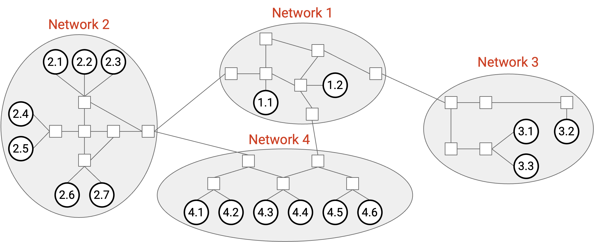

下图直观地展示了寻址。我们可以为每个网络分配一个数字；然后在网络 3 内部，可以为主机分配 3.1、3.2、3.3 等主机编号，其他网络中的主机也以类似方式编号。

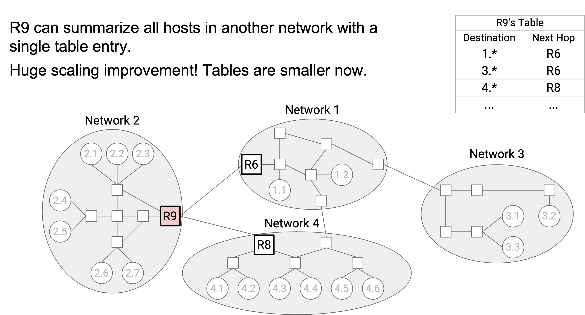

现在，考虑路由器 R9 中的转发表。此前，我们会为网络 1 中的每台主机各保存一条表项，且它们的下一跳（next hop）都为 R6。采用分层寻址后，我们可以只用一条表项表示整个本地网络：所有 `1.*` 地址（其中 `*` 表示任意数字）的下一跳都是 R6。类似地，也可以说所有 `2.*` 地址的下一跳都是 R8。

这种使用通配符匹配（wildcard match）来汇总路由的分层模型，会使转发表更小。

此外，这种模型也会使转发表更稳定。

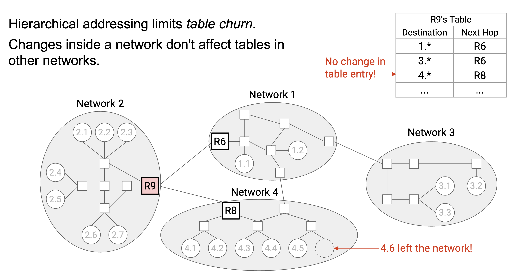

如果网络 1 内部的拓扑发生变化，我们不需要更新 R9 的转发表（也不需要更新其他网络中的任何转发表）。在实践中，本地网络内部的变化（例如新主机加入网络）远比网络之间的变化（例如新铺设地下电缆）频繁。因此，局部变化只影响局部转发表是一件好事。

更一般地说，地址由两部分组成：网络 ID（network ID）和主机 ID（host ID）。这使得域间路由协议（inter-domain routing protocol）可以专注于网络 ID，以寻找网络之间的路由；域内路由协议（intra-domain routing protocol）则可以专注于主机 ID，以寻找网络内部的路由。随着网络发生变化，这也会使路由协议更稳定：域间协议不关心网络内部的变化，域内协议也不关心其他网络中的变化。

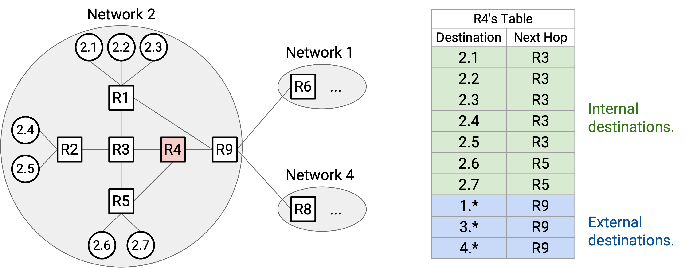

注意，R9 的转发表仍需要为其所在网络（即网络 2）内的每台主机保存单独的表项。

类似地，R4 是一台不连接其他网络的内部路由器（internal router），它既需要网络 3 内每台主机的表项，也需要其他网络的聚合表项（aggregated entry）（例如 `2.*` 的下一跳为 R9）。转发表的规模取决于同一网络内的内部主机数量，加上外部网络数量。

## 默认路由

现在我们知道，一条表项可以表示整个地址范围，而不必总是表示单个地址。我们可以进一步扩展这个想法，以提高可扩展性。

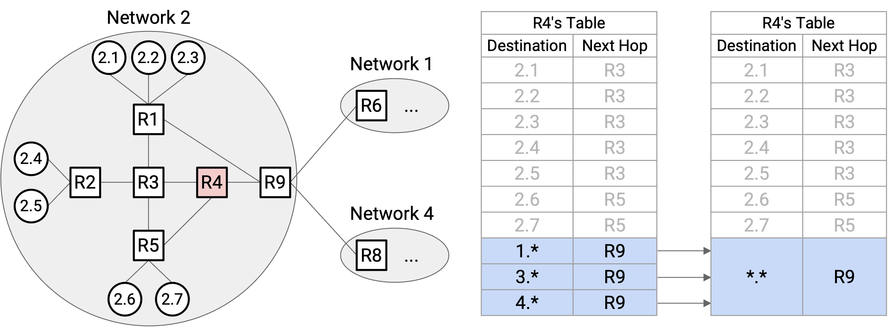

考虑 R4。它为每个外部网络（`1.*`、`3.*` 和 `4.*`）各有一条表项，且下一跳都为 R9。我们可以将所有外部网络聚合为一条表项。我们仍会为每台内部主机（`2.1`、`2.2` 等）保留表项，但在最后加上一条规则：对于所有未列在转发表中的其他主机，下一跳为 R9。

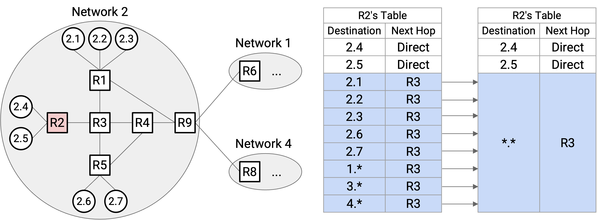

在 R2 上，我们可以使用更激进的聚合。与前面一样，所有外部网络的下一跳都是 R3；但 `2.1`、`2.2`、`2.3`、`2.6` 和 `2.7` 的下一跳也都是 R3。因此，转发表只需为 `2.4` 和 `2.5` 保留静态表项。然后我们可以规定：对于所有未列在转发表中的其他主机（包括一些内部主机和一些外部主机），下一跳均为 R3。

为了表示未列在转发表中的所有主机，我们可以使用匹配一切的通配符 `*.*`。向给定目的地转发时，路由器会先检查特定主机（例如 `3.1`）或范围（例如 `2.*`）是否匹配。如果路由器找不到任何匹配项，最终就会匹配 `*.*` 通配符。这称为**默认路由（default route）**。

大多数主机只有一条硬编码的默认路由。例如，主机 `2.4` 的转发表只有一条表项，即将所有内容发送给 R2。在实践中，你的家用计算机也只有一条表项，即将所有内容发送给家中的路由器。这就是主机不需要参与路由协议的原因。

## 分配分层 IP 地址：早期 Internet

为了获得更具可扩展性的路由，我们需要以某种分层方式分配地址。这些地址需要包含一些关于其位置的信息（例如，位置相近的主机需要共享地址中的某一部分）。

在早期 Internet 中，IPv4 地址与前面的直观版本一样，包含一个 8-bit 的网络 ID 和一个 24-bit 的主机 ID。

例如，AT&T 的网络 ID 是 12，Apple 的网络 ID 是 17，而美国国防部有 13 个不同的网络 ID。

8-bit 的网络 ID 意味着我们只能分配 256 个不同的网络 ID；但现实中，可能运营自己本地网络的组织远多于 256 个。此外，24-bit 的主机 ID 意味着每个网络会获得 $2^24 = 16,777,216$ 个地址。一个小型网络（例如只有 10 名员工的公司）大概不需要 1,600 万个地址。随着 Internet 规模扩大，我们需要一种新的编址方法。

## 分配分层 IP 地址：分类寻址

第一次修复尝试是**分类寻址（classful addressing）**，它根据需求分配不同大小的网络。在这种方法中，地址分为 3 类，每一类分配给网络 ID 和主机 ID 的 bit 数不同。最前面的 1–3 个 bit 标识当前使用的是哪一类。

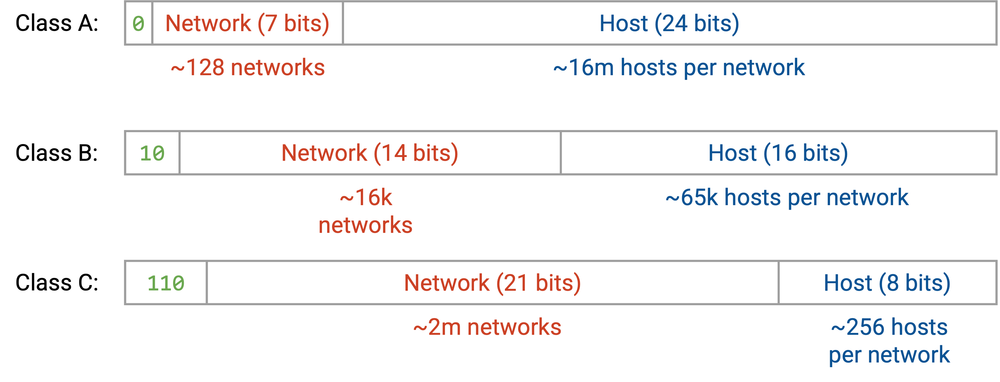

Class A 地址以最高位（leading bit）`0` 开头。接下来的 7 bits 是网络 ID（128 个网络），再接下来的 24 bits 是主机 ID（1,600 万台主机）。

Class B 地址以最高位 `10` 开头。接下来的 14 bits 是网络 ID（16,000 个网络），再接下来的 16 bits 是主机 ID（65,000 台主机）。

Class C 地址以最高位 `110` 开头。接下来的 21 bits 是网络 ID（200 万个网络），再接下来的 8 bits 是主机 ID（256 台主机）。

采用这种方法后，我们可以拥有 200 万 + 16,000 + 128 个不同的本地网络。主机更多的大型组织可以获得 Class A 网络，较小的组织可以获得 Class B 或 Class C 网络。和之前一样，在同一个网络内部，最高类别 bit 和网络 ID bits 相同，每台主机获得不同的主机 ID。

分类寻址的一个主要问题是每一类的大小。Class A（1,600 万台主机）对大多数组织而言太大，而 Class C（256 台主机）对大多数组织而言太小。因此，大多数网络需要落在 Class B 中。

不幸的是，Class B 网络 ID 只有 16,000 个。到 1994 年，我们已经快要用完 Class B 网络了。因此，又需要一种新的编址方法。

注意：在现代 Internet 中，分类寻址已经过时。

注意：严格来说，每个网络中的主机数量要少 2，因为全 0 地址和全 1 地址保留给特殊用途。例如，在 Class C 中，每个网络实际上有 254 台主机，而不是 256 台。

## 分配分层 IP 地址：CIDR

第三种分层寻址方法，也是现代 Internet 仍在使用的方法，是 **CIDR**（Classless Inter-Domain Routing，无类别域间路由）。在 CIDR 中，我们仍然使用变长的网络 ID，但不再只有 3 种不同的网络 ID 长度（Class A、B、C），而是让固定 bit 的数量任意可变。

例如，考虑前面那家只有 10 名员工的小公司。在分类寻址中，它会获得一个 Class C 网络，即 256 个主机地址。若它只需要 10 个主机地址，我们可以通过分配更长的网络 ID 来为它分配更少的地址。

如果分配 28-bit 的网络 ID，主机 ID 就是 4 bits（16 个可能的地址）。如果分配 29-bit 的网络 ID，主机 ID 就是 3 bits（8 个可能的地址）。我们无法恰好分配 10 个地址，但 28-bit 的网络 ID 已足以满足这家公司的需求。这里会有一点浪费（6 个未使用的地址），但仍远好于分配 256 个地址。

再举一个例子，考虑一个需要 450 个主机地址的组织。在分类寻址中，Class C（256 个地址）不够用，因此它会获得一个 Class B 网络，拥有 65,000 个主机地址，其中大多数地址都不会被使用。有了任意长度的网络 ID，我们可以分配一个 23-bit 的网络 ID，留下 9 bits 用于主机编址（512 个地址）。这能满足该组织的需求，并浪费少得多的地址。

## 多层分层分配

现实中的层级结构可以有多层。例如，在一个网络内部，组织可以选择将特定地址范围分配给特定的子组织（例如公司或大学中的部门）。

在实践中，我们利用现实世界中多层的组织与地理层级结构来分配地址。ICANN（Internet Corporation for Names and Numbers）是拥有所有 IP 地址的全球组织。

ICANN 会将地址块分配给区域互联网注册管理机构（Regional Internet Registry，RIR），每个 RIR 代表特定国家或大洲。例如，RIPE 获得欧盟的所有地址，ARIN 获得北美地址，APNIC 获得亚太地址，LACNIC 获得南美地址，AFRINIC 获得非洲地址。示例：ICANN 将所有以 `1101` 开头的地址分配给 ARIN。

接着，每个 RIR 会将自己范围的一部分分配给大型组织（例如公司、大学）或 ISP。这些组织或 ISP 称为本地互联网注册管理机构（Local Internet Registry）。示例：ARIN 控制所有以 `1101` 开头的地址，并将所有以 `1101 11001` 开头的地址分配给 AT&T。

最后，每个本地互联网注册管理机构会将单个 IP 分配给具体主机。为了增加层级，本地注册管理机构也可以将 IP 范围分配给小型组织，小型组织再依次分配单个 IP。

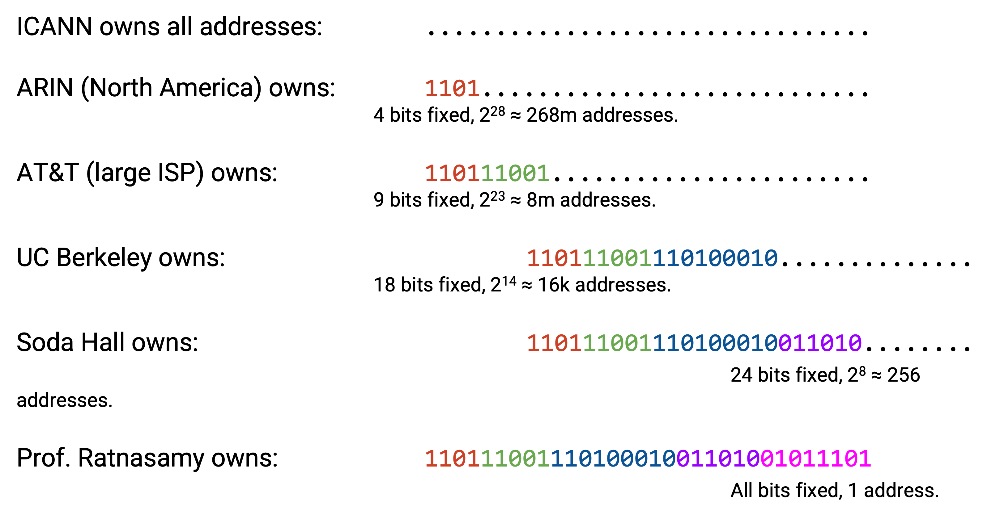

在每一层，额外固定多少个 bit 取决于要分配多少个地址。例如，ARIN 可能想给 AT&T 分配 800 万个地址，并计算出固定 9 bits 会得到 800 万个主机地址。ARIN 已经固定了 4 bits，因此它再固定 5 bits，并将所有以这 9 bits 开头的地址分配给 AT&T。随后，AT&T 可能将前缀 `1101 11001 110100010` 分配给 UC Berkeley，以提供 16,000 个地址。随着我们向子组织分配地址，更多 bit 会被固定，同时始终保留父组织已经固定的 bit。

## IP 地址的写法

我们可以将 IP 地址写成由 `1` 和 `0` 构成的 32-bit 序列，也可以写成一个很大的整数。实践中，为了可读性，我们将每一组 8 bits 写成一个整数（范围为 0 到 255）。例如，IP 地址 `00010001 00100010 10011110 00000101` 可以写成 `17.34.158.5`。这种表示法有时称为**点分四组表示法（dotted quad representation）**。

到目前为止，我们一直将地址范围写成 bit（例如，所有以 `1101` 开头的 IP）。为了写出一个地址范围，我们可以使用**斜杠表示法（slash notation）**。先写出固定的前缀，再为所有其余未固定的 bit 写 `0`，并将得到的 32-bit 值转换为点分四组 IP 地址。然后在斜杠后写出固定 bit 的数量。

例如，如果前缀是 `11000000`，我们为所有未固定的 bit 添加 `0`，得到 `11000000 00000000 00000000 00000000`。作为一个 32-bit 地址，它是 `192.0.0.0`。然后，因为固定了 8 bits，我们将此范围写成 `192.0.0.0/8`。

要将单个地址写成一个范围，可以写成类似 `192.168.1.1/32`，表示全部 32 bits 都已固定。此外，默认路由 `*.*` 可以写成 `0.0.0.0/0`。

斜杠表示法有时看起来有些令人困惑，因为我们使用任意的 8-bit 分段，并以十进制书写数字。例如，8-bit 前缀 `11000000` 和 12-bit 前缀 `11000000 0000` 分别写成 `192.0.0.0/8` 和 `192.0.0.0/12`（同一个 IP 地址表示不同的范围）。再举一例：如果我拥有 4-bit 前缀 `1100`，就可以分配 5-bit 前缀 `11001`。作为范围，它们写成 `192.0.0.0/4` 和 `200.0.0.0/5`。乍看之下，很难看出第二个范围其实是第一个范围的子集，必须写出 bit 才能确认。

斜杠表示法中斜杠（例如 `/16`）的另一种替代方式是**网络掩码（netmask）**。与斜杠后的数字一样，网络掩码告诉我们哪些 bit 是固定的。要写出网络掩码，我们将所有固定 bit 写成 `1`，所有未固定 bit 写成 `0`，并将结果转换成点分四组表示法。例如，如果范围是 `192.168.1.0/29`，我们可以写出 29 个 `1`（固定 bit）和 3 个 `0`（未固定 bit）。`11111111 11111111 11111111 11111000` 写成点分四组表示法就是 `255.255.255.248`。使用网络掩码表示法时，这个范围是 `192.168.1.0`，网络掩码是 `255.255.255.248`（用网络掩码替代斜杠）。

在这些讲义中，我们通常使用斜杠表示法，因为它更便于阅读。实践中，网络掩码也很有用：给定一个具体 IP 地址，如果在该 IP 地址和网络掩码之间执行按位 AND（bitwise AND），所有主机 bit 都会被清零，只剩下网络 bit。

## 使用 CIDR 聚合路由

在最初的网络 ID 和主机 ID 模型中，我们可以将同一网络内的所有主机聚合为转发表中的一条路由（例如，`2.*` 表示网络 2 中的一切）。

多层分层寻址意味着，我们也可以将多个网络聚合为一条路由。

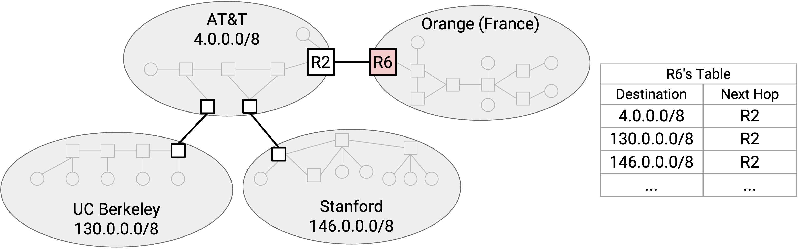

考虑这张网络图。在最初的模型中，R6 需要分别为 AT&T、UCB 和 Stanford 准备转发表项。

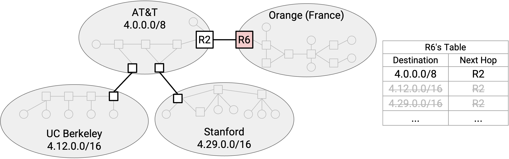

然而，如果使用分层寻址，UCB 的范围（`4.12.0.0/16`）和 Stanford 的范围（`4.29.0.0/16`）都是 AT&T 范围（`4.0.0.0/8`）的子集。如果 AT&T 将这些范围分配给其下游客户 UCB 和 Stanford，就可能出现这种情况。

现在，R6 只需一条表项就能表示 AT&T、UCB 和 Stanford。我们将两个较小的范围聚合进它们共同所属的更大范围。

## 多宿主（Multi-Homing）

聚合地址范围并不总是有效。假设我们添加一条从 R6 直接连接到 Stanford 的链路。

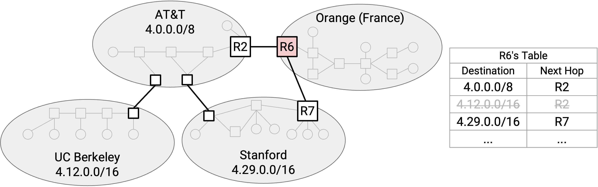

聚合后的路由表明，所有发往 AT&T（及其下属组织）的数据包（packet）下一跳都是 R2。我们需要添加一条额外表项，表明 Stanford 的下一跳是 R7。

注意，我们的转发表现在有了彼此重叠的范围。一个目的地可能匹配多个范围。为了选择路由，我们会执行**最长前缀匹配（longest prefix matching）**，即使用与目的地 IP 地址匹配的、最具体的范围。例如，如果有一个数据包发往 UCM 主机，我们会使用 UCM 专属表项，因为它具有更长的 19-bit 前缀。即使 9-bit 的 AT&T 表项也匹配该目的地，它的前缀更短，因此我们不使用这条路由。

如果数据包发往 UCB 主机，就不能使用 Stanford 专属表项，因为 16-bit 前缀不会匹配 UCB 主机。不过，我们仍可以使用 8-bit 的 AT&T 表项，它会匹配该目的地。

## IPv6 简史

IPv4 地址为 32 bits，这意味着我们大约有 40 亿个可用地址。这够吗？

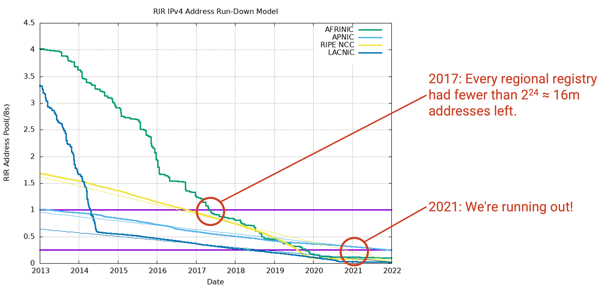

这张图绘制了各区域注册管理机构随时间变化的剩余未分配 IP 地址数量（纵轴）。

到 2017 年，所有人可用的地址都少于一个 `/8` 块（即少于 $2^24 = 1600$ 万个地址）。每个区域注册管理机构都保留了一个备用 `/8` 地址块以防万一；但到 2017 年，所有人都不得不开始使用自己的备用地址。到 2021 年，即使备用地址也快耗尽了。

小知识：2011 年 2 月，最后一个 `/8` 地址块被分配时，还举行了一场线下仪式，甚至颁发了特别的纸质证书。

随着 Internet 增长，我们开始意识到地址终有一天会耗尽。幸运的是，这一点很早就被意识到，因此 IPv6 在 1998 年被开发出来，用以应对 IP 地址耗尽（IP address exhaustion）。

从根本上说，IPv6 的编址结构与 IPv4 相同。IPv6 需要进行一些较小的实现改动，不过这些与这里的讨论无关。

IPv6 的主要新特性是更长的地址。IPv6 地址长 128 bits，这意味着大约有 $3.4 \times 10^{38}$ 个可能的地址。这是一个天文数字，因此我们永远不会用完。宇宙的年龄为 $10^{21}$ 秒，所以即使每秒都分配一个地址，也只会用掉所有可用地址的 0.000000000000001%。

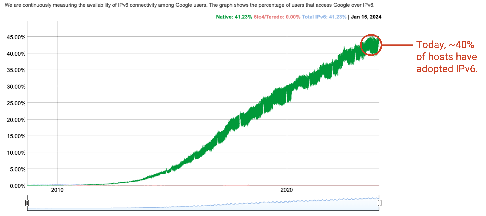

IPv6 开发于 1990 年代，但并未立即被所有计算机采用。即使在 2010 年，基本上也没有人使用 IPv6。截至 2024 年，约 45% 的终端用户（end user）使用 IPv6，其中大多数用户位于 Internet 普及率更高的发达国家。IPv6 越来越广泛采用的主要原因，是 IPv4 地址正在耗尽。

为什么 IPv6 的采用如此缓慢？用户、服务器和 Internet 运营者都必须升级软件和硬件（例如路由器、链路、计算机上的设备驱动程序），以支持 IPv6。路由器现在需要两张转发表：一张使用 IPv4 地址，另一张使用 IPv6 地址。

IPv6 升级必须保持向后兼容（backwards-compatible）。如果某台服务器只有 IPv6 地址，使用只支持 IPv4 的旧计算机的用户就无法使用该服务器。IPv4 和 IPv6 本质上是彼此独立的编址系统，无法在 IPv4 地址和 IPv6 地址之间转换。截至 2024 年，许多计算机仍不支持 IPv6，因此许多服务需要同时支持 IPv4 和 IPv6。

同时支持 IPv4 和 IPv6 的计算机还必须考虑使用哪一个。某个版本一定更好吗？实践中，IPv6 更快，但许多其他实现细节也会影响你的选择。

## IPv6 地址表示法

IPv6 地址通常以十六进制而非十进制书写。例如：

`2001:0D08:CAFE:BEEF:DEAD:1234:5678:9012`

这是一个 IPv6 地址（32 个十六进制数字 = 128 bits）。为提高可读性，我们在每 4 个十六进制数字（16 bits）之间添加一个冒号。

为提高可读性，我们可以省略每个 4 位块中的前导零（leading zero）。例如：

`2001:0DB8:0000:0000:0000:0000:0000:0001`

可以缩写为 `2001:DB8:0:0:0:0:0:1`。

为提高可读性，我们还可以省略一长串零，例如 `2001:DB8::1`。双冒号表示将所有缺失的 4 位块补成 `0000`。每个地址只能这样做一次。（省略两段范围会造成歧义，因为我们不知道每段应填入多少个零。）

斜杠表示法在 IPv6 中仍然可以使用。单个地址是 `/128`（所有 bit 均固定）。一个 32-bit 前缀可能写成 `2001:0DB8::/32`。

由于地址空间极大，在 IPv6 中，你可以将网络 ID 固定为 64 bits，将主机 ID 也固定为 64 bits，并且仍然永远不会用完网络 ID 或主机 ID。事实上，存在一些特殊协议，允许网络和主机选择自己的 64-bit 网络 ID 和主机 ID（并检查没有其他人正在使用它），而不需要由某个组织分配具体 ID。

实践中，区域注册管理机构通常将 32-bit 前缀分配给 ISP，ISP 通常将 48-bit 前缀分配给组织。该组织随后可以将 64-bit 前缀分配给更小的子网络。在 IPv6 中，我们通常不会看到长于 `/64` 的前缀。即使是组织内部最小的子网络，也有一个 64-bit 前缀，并使用 64 bits 为具体主机编址。使用这些标准化前缀长度，可以让前缀携带更多信息。例如，在 IPv6 中，很难看出 `/19` 前缀表示什么；但在 IPv6 中，我们知道 `/32` 前缀通常表示一个 ISP。TODO：请复核此处。
